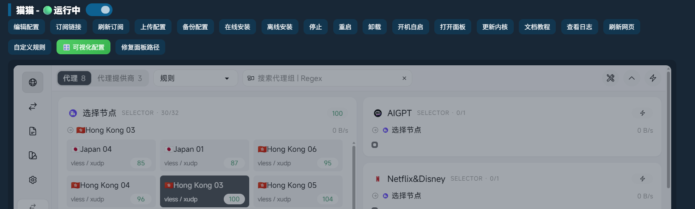
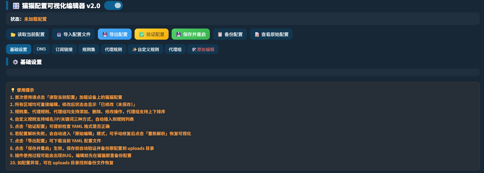

# 🐱 猫猫插件 · Cat Best

面向 **UFI-TOOLS 后台**的 Mihomo / Clash 管理插件，集成日常管理、订阅导入、自定义规则和**可视化配置编辑器 v2.0**，让配置修改与运行维护集中在一个页面完成。

本项目以单个 JavaScript 文件提供，需要在兼容的 UFI-TOOLS 插件环境中加载。

## 界面预览

### 猫猫管理与代理面板



### 可视化配置编辑器 v2.0



> 编辑器首次打开时可能显示「未加载配置」，点击「读取当前配置」即可开始。

## 功能一览

| 模块 | 功能 |
| --- | --- |
| 安装管理 | 在线安装、本地 ZIP 离线安装，包含新旧安装包结构的兼容处理 |
| 运行管理 | 查看运行状态、停止、重启、开机自启、卸载 |
| 配置管理 | 编辑原始配置、上传配置、备份并下载配置 |
| 订阅管理 | 最多输入 3 条订阅，提供订阅转换与单条 Clash 订阅直接导入入口 |
| 订阅刷新 | 仅更新 `proxy-providers` 节点，或使用已保存的订阅信息整份刷新 |
| 可视化编辑 | 基础设置、DNS、订阅提供者、规则集、代理规则、代理组 |
| 自定义规则 | 独立规则文件管理，以及编辑器内的域名 / IP / 关键词规则添加 |
| 运维工具 | 内核文件上传、日志查看 / 下载 / 清空、面板路径修复、网页刷新 |

## 运行环境

- 可加载自定义 JavaScript 插件的 UFI-TOOLS 后台。
- 设备已开启高级功能，且后台能够以 root 权限执行命令。
- 兼容的猫猫 / Mihomo TProxy 安装包及其运行依赖。
- 支持现代 JavaScript、文件上传和下载的浏览器。

脚本依赖宿主提供的 `runShellWithRoot`、`createToast`、`createFixedToast`、`collapseGen`、`KANO_baseURL`、`common_headers`、`UFI_DATA` 等接口或全局对象，以及后台页面结构。

设备端路径按 `/data/clash` 和应用包名 `com.minikano.f50_sms` 编写；更换后台、应用包名或目录布局时，需要适配。部分功能调用 `yq_linux_arm64`，实际可用性也取决于安装包与设备架构。

## 安装与首次使用

### 1. 加载插件

下载仓库中的 [cat-best.js](cat-best.js)，通过所用 UFI-TOOLS 版本的自定义插件入口加载。具体入口和导入方式以宿主后台为准。

加载完成后，页面应出现「猫猫」管理区域。若替换已有猫猫插件，先备份旧脚本，并避免同时加载重复的管理插件。

### 2. 安装猫猫运行组件

如果设备尚未安装猫猫，可选择：

- **在线安装**：点击「在线安装」，脚本从预设地址下载安装包并执行安装，需要设备能够访问下载源。
- - **离线安装（推荐）**：先下载 mihomo-tproxy.zip (https://github.com/yingxuzi/cat/releases/download/v1.0/mihomo-tproxy.zip)，再点击「离线安装」选择下载的文件。

离线安装仅省去安装包的在线下载；后续订阅、规则集等更新仍可能需要网络。安装流程会写入 `/data/clash` 并添加开机启动项。已安装时，脚本会提示，无需重复安装。

### 3. 导入配置或订阅

已有完整 YAML 配置时，使用「上传配置」；需要输入订阅地址时，使用「订阅链接」。订阅转换支持最多 3 条地址，直接导入模式限单条 Clash 格式订阅；选择直接导入但填写多条地址时，会改用订阅转换。

订阅处理依赖设备端服务脚本。插件将订阅地址或转换输入写入配置入口，再由服务处理，并非在浏览器内完成订阅下载与转换。

### 4. 打开代理面板

点击「打开面板」，或使用管理区域中的内嵌面板。脚本默认使用：

```text
http://<设备局域网 IP>:7788/ui/
```

请将占位内容替换成设备的实际地址；访问时需能够连通设备对应端口。

## 可视化配置编辑

1. 点击「🎛️ 可视化配置」。
2. 点击「读取当前配置」，或通过「导入配置文件」选择本地 `.yaml`、`.yml`、`.txt` 文件。
3. 在对应标签中编辑基础设置、DNS、订阅链接、规则集、代理规则或代理组；代理组支持上下排序。
4. 点击「验证配置」执行基础结构检查，并通过「查看原始配置」核对生成的 YAML。
5. 点击「保存并重启」，确认后写入设备配置并重启内核；也可以先「导出配置」下载文件。

导入文件和页面编辑不会立即写入设备，需要执行「保存并重启」才会应用。保存流程包含备份原配置的步骤，备份位置见下文。

解析抛出错误时，编辑器会进入「原始编辑」模式；修改后可点击「重新解析」。

> 编辑器使用内置的简化 YAML 解析器。「验证配置」只检查部分字段类型与基础结构，不等于完整 YAML 校验，也不等于 Mihomo 内核校验。复杂 YAML 语法、行内集合、锚点、别名或多行文本可能无法准确处理；可视化保存会重新序列化配置，原有注释、格式和部分语义可能发生变化。复杂配置请先导出并核对。

## 两种订阅刷新方式

| 方式 | 行为 | 使用条件 |
| --- | --- | --- |
| 仅更新节点 | 尝试通过内核 API 刷新 `proxy-providers`，保留现有 YAML；失败时尝试清理订阅缓存并重启 | 当前配置包含 `proxy-providers`，且相关依赖可用 |
| 整份配置重新刷新 | 将 `.sub_url` 中保存的订阅输入重新写入 `config.yaml` 并重启，由设备端服务继续处理 | 已通过「订阅链接」保存过订阅信息 |

**需要保留手动修改的规则、DNS 和代理组时，优先选择「仅更新节点」。** 整份刷新会覆盖当前配置，操作前请先下载备份。

## 自定义规则

插件提供两个入口，存储方式不同：

| 入口 | 存储与生效方式 |
| --- | --- |
| 管理区域「自定义规则」 | 保存到 `custom_rules.yaml`；本插件安装流程会注入启动前合并脚本，将规则插入主配置的 `rules:` 开头 |
| 编辑器「✨自定义规则」 | 随编辑器保存写入主配置的标记区块；当前实现将其追加在已有规则后面 |

独立规则入口支持 `DOMAIN-SUFFIX`、`DOMAIN`、`DOMAIN-KEYWORD`、`IP-CIDR`、`IP-CIDR6`、`DST-PORT`、`SRC-PORT`、`GEOIP` 等类型。例如：

```text
DOMAIN-SUFFIX,example.com,DIRECT
DOMAIN-KEYWORD,example,选择节点
IP-CIDR,192.168.0.0/16,DIRECT
```

策略名称必须与实际配置中的代理组或内置策略匹配。编辑器的快捷添加入口提供域名、IP / IP 段、关键词三种方式。

规则按顺序匹配。如果已有规则包含 `MATCH` 等兜底项，排在其后的自定义规则可能无法生效；保存前请在规则列表或原始配置中检查顺序。已有安装若缺少本插件注入的合并脚本，独立规则文件也可能无法自动合并。

## 文件位置与备份恢复

以下均为**运行 UFI-TOOLS 的设备端路径**：

| 路径 | 用途 |
| --- | --- |
| `/data/clash/` | 猫猫运行目录 |
| `/data/clash/Proxy/config.yaml` | 主配置 |
| `/data/clash/Proxy/custom_rules.yaml` | 独立自定义规则文件 |
| `/data/clash/Proxy/.sub_url` | 已保存的订阅输入 |
| `/data/clash/Scripts/Clash.Service` | 服务启停入口 |
| `/data/clash/Scripts/merge_custom_rules.sh` | 安装时注入的规则合并脚本 |
| `/data/clash/Proxy/WebUI/zashboard/` | 面板静态文件 |
| `/data/data/com.minikano.f50_sms/files/uploads/` | 配置备份等上传文件 |
| `/sdcard/Clash内核日志.txt` | 内核日志 |
| `/sdcard/ufi_tools_boot.sh` | 开机启动脚本 |

编辑器保存前会尝试将旧配置复制到 `uploads/mm_config_backup_<时间戳>.yaml`。请确认备份文件实际存在；当前实现未逐项校验所有备份、写入和重启命令的执行结果。

恢复时，取出对应备份，通过「上传配置」重新上传；也可在编辑器中导入备份、核对后保存重启。管理区域「备份配置」会下载配置，但同时会清理设备上传目录中既有的 `mm_config_backup*` 文件，重要备份请另存到电脑。

## 常见问题

### 提示「没有开启高级功能」

检查 UFI-TOOLS 的高级功能和 root 授权。脚本通过执行 `whoami` 检查权限。

### 在线安装失败

检查设备网络和安装包下载源是否可达，或改用「离线安装」。安装包需要包含兼容的服务脚本及内核 / 管理程序，任意 ZIP 文件无法替代。

### 面板空白或路径异常

先检查服务状态及设备 `7788` 端口是否可访问。如果存在 `WebUI/zashboard/zashboard/` 嵌套目录，可使用「修复面板路径」。该操作会清理外层目录中的其他内容，再将内层文件移到外层；自定义过面板文件时，请先备份。

### 配置验证通过，但内核无法启动

页面校验范围有限。检查「查看日志」中的错误，核对配置字段、代理组引用和规则顺序，必要时恢复备份。

### 上传内核后没有生效

当前上传入口检查文件是否具有 ELF 文件头，并替换 `Proxy/Clash.Core`；它不检查 CPU 架构，也不覆盖所有新版安装包的内核布局。使用前应确认二进制与设备架构、安装包实际启动路径匹配。

## 仓库结构

```text
.
├── README.md
├── cat-best.js
└── docs/
    └── images/
        ├── dashboard.png
        └── visual-editor.png
```

## 反馈问题

提交 Issue 时，请附上设备型号与架构、UFI-TOOLS 版本、安装包版本、操作步骤和相关日志片段。涉及配置时提供脱敏后的最小示例，并移除订阅地址、密码、令牌及其他私人信息。

## 许可与致谢

感谢 UFI-TOOLS、Mihomo / Clash、Zashboard 及相关插件与配置工具的贡献者。

本仓库尚未声明许可证，转载、修改和分发前请确认原始脚本及相关组件的授权要求。第三方组件与安装包遵循各自的许可。
